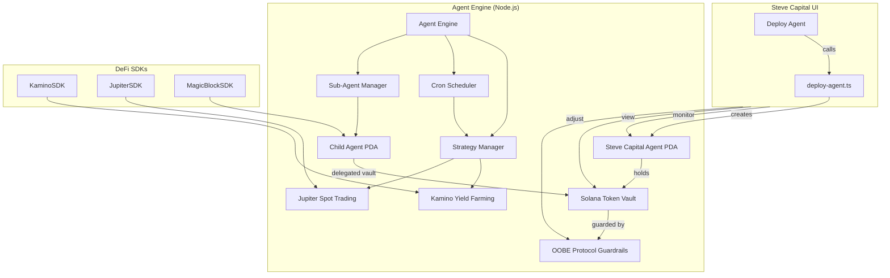

# solana-steve-capital-agent

> **Autonomous, programmable capital agents on Solana** – Deploy, fund, configure, and run multi‑strategy DeFi bots that operate under on‑chain guardrails via the Steve Capital SDK and OOBE Protocol.

---

## Table of Contents

- [Overview](#overview)
- [Architecture Diagram](#architecture-diagram)
- [Prerequisites](#prerequisites)
- [Repository Structure](#repository-structure)
- [Installation & Local Development](#installation--local-development)
- [Quickstart: Deploy & Run Your First Agent](#quickstart-deploy--run-your-first-agent)
- [Configuration (`config.ts`)](#configuration-configts)
- [Strategy Modules](#strategy-modules)
  - [Kamino Yield Farming](#kamino-yield-farming-strategy)
  - [Jupiter Spot Trading](#jupiter-spot-trading-strategy)
- [Sub‑Agent Manager](#sub‑agent-manager)
- [Scheduled Execution (Cron‑like Bot)](#scheduled-execution-cron‑like-bot)
- [Testing](#testing)
- [CI/CD (GitHub Actions)](#cicd-github-actions)
- [Troubleshooting](#troubleshooting)
- [Contributing](#contributing)
- [License](#license)

---

## Overview

`solana-steve-capital-agent` is a production‑grade framework that lets you:

1. **Deploy** an autonomous capital agent through the Steve Capital UI using a single CLI script.
2. **Fund** the agent’s on‑chain vault (≥ 20 USDC or equivalent SOL on devnet) and lock it behind programmable guardrails (spending limits, risk caps, execution mandates).
3. **Configure** guardrails via a TypeScript config file (`config.ts`) and have them enforced on‑chain by the OOBE Protocol runtime.
4. **Implement** multiple DeFi strategies (e.g., Kamino yield farming, Jupiter spot swaps) that are published to Steve Capital and executed automatically.
5. **Monitor** markets and trigger trades on a schedule (cron‑like) inside the Agent Engine.
6. **Create Sub‑Agents** with delegated vault access and restricted permissions for private swaps (e.g., MagicBlock).

All components are written in TypeScript, run on Node.js ≥ 18, and interact with Solana via `@solana/web3.js` and `@project-serum/anchor`. The SDKs for the various DEXes and liquidity providers are abstracted behind the **SAP MCP routing layer**.

---

## Architecture Diagram



---

## Prerequisites

| Tool | Minimum Version | Why |
|------|----------------|-----|
| **Node.js** | 18.x | ES2022 features, native ESM support |
| **npm** | 9.x | Package management |
| **Docker** | 24.x | Containerised dev environment (optional) |
| **Solana CLI** | 1.18.x | Keypair generation, airdrops |
| **Steve Capital CLI** | latest (via `npm i -g @stevecapital/cli`) | Deploy & register agents |
| **Git** | any | Source control |
| **Jupiter SDK**, **Kamino SDK**, **MagicBlock SDK**, **Ace Data Cloud SDK** | installed via `npm` (see `package.json`) | DeFi integrations |

> **Tip:** Use `nvm` to manage Node versions and `solana-test-validator` for a local devnet if you don’t want to use the public devnet.

---

## Repository Structure

```
├─ src
│  ├─ config.ts                # Global agent configuration (guardrails, limits)
│  ├─ deploy-agent.ts          # CLI script that registers the agent on Steve Capital
│  ├─ engine
│  │   ├─ AgentEngine.ts       # Core loop, scheduler, health checks
│  │   ├─ StrategyManager.ts   # Loads & orchestrates strategy modules
│  │   └─ SubAgentManager.ts   # Handles creation & permissioning of sub‑agents
│  ├─ strategies
│  │   ├─ kaminoYield.ts       # Kamino yield‑farming implementation
│  │   └─ jupiterSpot.ts       # Jupiter spot‑swap implementation
│  └─ utils
│      ├─ logger.ts
│      └─ solanaHelpers.ts
├─ test
│  ├─ unit
│  └─ integration
├─ Dockerfile
├─ docker-compose.yml
├─ .github
│  └─ workflows
│      └─ ci.yml
├─ package.json
└─ README.md
```

---

## Installation & Local Development

```bash
# 1️⃣ Clone the repo
git clone https://github.com/your-org/solana-steve-capital-agent.git
cd solana-steve-capital-agent

# 2️⃣ Install dependencies (uses npm workspaces)
npm ci

# 3️⃣ Build TypeScript
npm run build

# 4️⃣ (Optional) Spin up a local Solana validator + Redis for the scheduler
docker compose up -d validator redis

# 5️⃣ Verify the build
npm run lint && npm run test
```

**NPM Scripts**

| Script | Description |
|--------|-------------|
| `build` | `tsc -p tsconfig.json` |
| `dev` | Run the engine in watch mode (`ts-node-dev src/engine/AgentEngine.ts`) |
| `lint` | `eslint . --ext .ts` |
| `test` | `jest --coverage` |
| `docker:build` | Build the production Docker image |
| `docker:run` | Run the container (expects env vars, see `.env.example`) |

---

## Quickstart: Deploy & Run Your First Agent

### 1️⃣ Prepare a Solana wallet

```bash
# Generate a new keypair (or use an existing one)
solana-keygen new -o ~/.config/solana/agent-keypair.json

# Set the keypair as the default for the CLI
export SOLANA_KEYPAIR=~/.config/solana/agent-keypair.json
export SOLANA_URL=https://api.devnet.solana.com
```

### 2️⃣ Fund the wallet & vault

```bash
# Airdrop 2 SOL to the wallet (devnet)
solana airdrop 2 $SOLANA_KEYPAIR

# Deploy the agent (this creates the PDA vault)
npm run deploy-agent

# After deployment, fund the vault with at least 20 USDC
# USDC mint address on devnet: 8XSjZcZcK9K7g9hVh9KcXc9K7g9hVh9KcXc9K7g9hVh9KcXc9K7g9hVh9KcXc9K7g9hVh9KcXc9K7g9hVh9KcXc9K7g9hVh9KcXc9K7g9hVh9KcXc9K7g9hVh9KcXc9K7g9hVh9KcXc9K7g9hVh9KcXc9K7g9hVh9KcXc9K7g9hVh9KcXc9K7g9hVh9KcXc9K7g9hVh9KcXc9K7g9hVh9KcXc9K7g9hVh9KcXc9K7g9hVh9KcXc9K7g9hVh9KcXc9K7g9hVh9KcXc9K7g9hVh9KcXc9K7g9hVh9KcXc9K7g9hVh9KcXc9K7g9hVh9KcXc9K7g9hVh9KcXc9K7g9hVh9KcXc9K7g9hVh9KcXc9K7g9hVh9KcXc9K7g9hVh9KcXc9K7g9hVh9KcXc9K7g9hVh9KcXc9K7g9hVh9KcXc9K7g9hVh9KcXc9K7g9hVh9KcXc9K7g9hVh9KcXc9K7g9hVh9KcXc9K7g9hVh9KcXc9K7g9hVh9KcXc9K7g9hVh9KcXc9K7g9hVh9KcXc9K7g9hVh9KcXc9K7g9hVh9KcXc9K7g9hVh9KcXc9K7g9hVh9KcXc9K7g9hVh9KcXc9K7g9hVh9KcXc9K7g9hVh9KcXc9K7g9hVh9KcXc9K7g9hVh9KcXc9K7g9hVh9KcXc9K7g9hVh9KcXc9K7g9hVh9KcXc9K7g9hVh9KcXc9K7g9hVh9KcXc9K7g9hVh9KcXc9K7g9hVh9KcXc9K7g9hVh9KcXc9K7g9hVh9KcXc9K7g9hVh9KcXc9K7g9hVh9KcXc9K7g9hVh9KcXc9K7g9hVh9KcXc9K7g9hVh9KcXc9K7g9hVh9KcXc9K7g9hVh9KcXc9K7g9hVh9KcXc9K7g9hVh9KcXc9K7g9hVh9KcXc9K7g9hVh9KcXc9K7g9hVh9KcXc9K7g9hVh9KcXc9K7g9hVh9KcXc9K7g9hVh9KcXc9K7g9hVh9KcXc9K7g9hVh9KcXc9K7g9hVh9KcXc9K7g9hVh9KcXc9K7g9hVh9KcXc9K7g9hVh9KcXc9K7g9hVh9KcXc9K7g9hVh9KcXc9K7g9hVh9KcXc9K7g9hVh9KcXc9K7g9hVh9KcXc9K7g9hVh9KcXc9K7g9hVh9KcXc9K7g9hVh9KcXc9K7g9hVh9KcXc9K7g9hVh9KcXc9K7g9hVh9KcXc9K7g9hVh9KcX